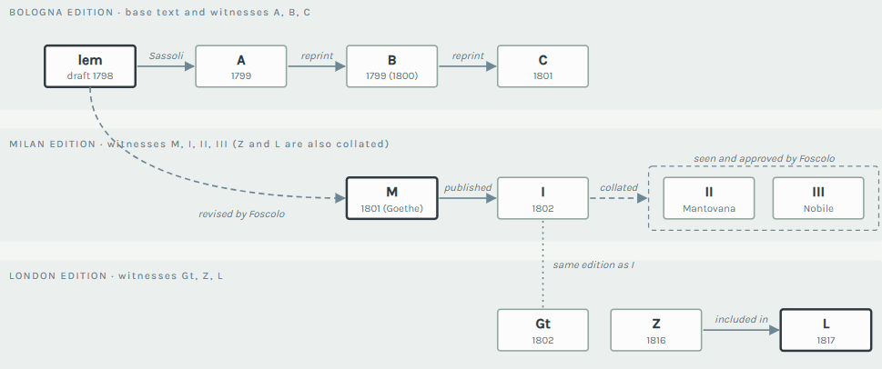
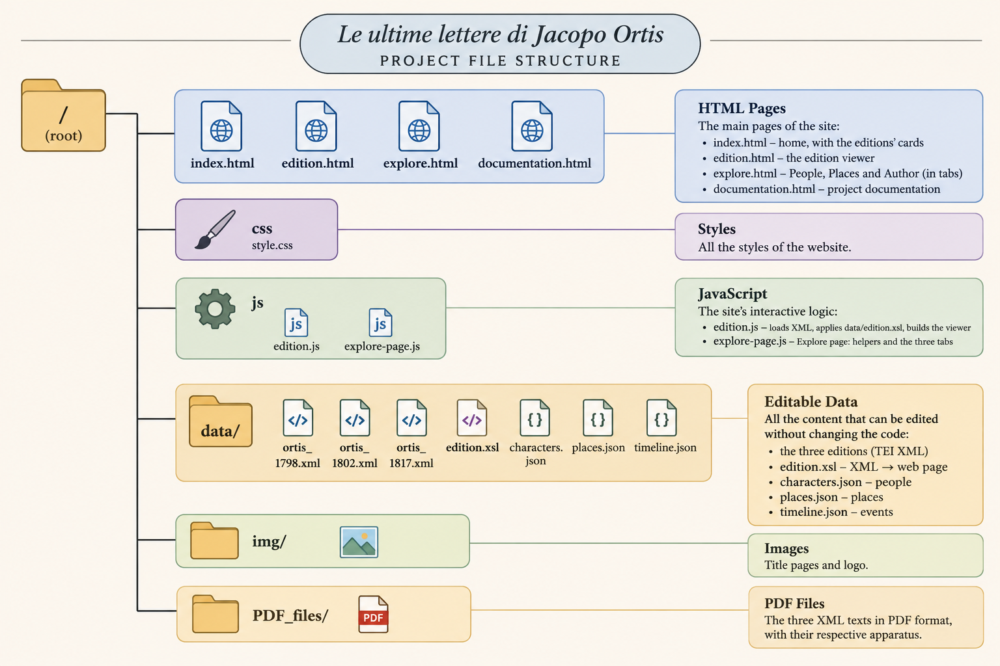

# Ortis Letters

A digital edition prototype of Ugo Foscolo's *Ultime lettere di Jacopo Ortis*: three TEI/XML editions with their variants, a page to explore people, places and the author's life, and the documentation. The text is based on Gambarin, Giovanni, ed. 1970. "Ultime lettere di Jacopo Ortis". By Ugo Foscolo. "Edizione nazionale delle opere di Ugo Foscolo 4". Firenze: Le Monnier.

## Textual witnesses

The diagram below illustrates the textual witnesses encoded in the three TEI/XML editions and their relationships.

*Figure 2. Overview of the textual witnesses encoded in the three XML files.*

## Run it locally

The pages load XML and JSON with `fetch()`, so open the site through a web server, not by double-clicking the files:

- VS Code: open the project folder and use the *Live Server* extension, or
- terminal, inside the project folder: `py -m http.server 8000` (Windows) or `python3 -m http.server 8000`, then open `http://localhost:8000`.

## Files

*Figure 1. Structure of the Ortis Letters repository.*

## Extend an edition (XML)

1. **A new letter.** Copy a `<div2 type="epistola" n="5">` block in the XML, change `n`, and add the date line and the paragraphs. The table of contents, the numbering of the variants and the apparatus are generated automatically.
2. **A variant.** Wrap the point of variation in `<app type="…"><lem wit="…">…</lem><rdg wit="…">…</rdg></app>`. The `wit` values are the `xml:id` of the witnesses listed in the header (`listWit`). Allowed `type` values: `punctuation`, `capitalisation`, `orthographic`, `morphological`, `lexical`, `syntactic`, `addition`, `omission`, `rewriting`, `layout`, `paratext`, `mixed` (with the parts in `subtype`, e.g. `lexical-omission`).
3. **A new witness.** Add a `<witness xml:id="…">` to `listWit` in the header; it appears automatically in the window menus.
4. **A new edition.** Add its XML to `data/`, then: add an entry to `EDITIONS` in `js/edition.js` (label, xml path, title, source line, about text), a button in `edition.html`, and a card in `index.html`.
5. **Page texts.** The title, the source line and the "About this edition" text of each edition are written in `EDITIONS` in `js/edition.js`.

## People and places

Names in the XML are tagged `<persName ref="#JO">` and `<placeName ref="#PD">`. To add one:

1. Add it to the header of the XML (`listPerson` or `listPlace`) with the same `xml:id`.
2. Add it to `data/characters.json` or `data/places.json`:
   - people: `id`, `name`, `type` (`character` or `mentioned`), `role`, `description`, `appearances` (edition ids with the sections where it appears), `related_places`, `links`; the lines of the graph are the `relations` at the end of the file;
   - places: `id`, `name`, `type` (`city`, `hills`, `country`), `lat`, `lon`, `role`, `description`, `appearances`, `related_characters`, `links`.
3. The ids of the editions in `appearances` are `bolo-1798`, `mil-1802` and `lon-1817`.

The Author timeline works the same way: add an object to `data/timeline.json` (`id`, `year`, `date`, `type` = `life`, `work` or `edition`, `title`, `place`, `description`; optionally `places` with place ids, `edition` and `image`).

## License

The HTML pages, CSS, JSON, and JavaScript files are released under the MIT License.

The apparatus in the three XML files encoding Giovanni Gambarin's text are subject to Italian copyright law (Law No. 633/1941). They are not covered by the MIT License. All rights remain with their respective copyright holders. 

## Contribute

Fork the repository, change the files above, check the pages in the browser and open a pull request. Questions: ilaria.dedominicis2@studio.unibo.it

## Cite 

De Dominicis, I. (2026). Ortis Letters: The Prototype for a Digital Edition of Foscolo's Ultime lettere di Jacopo Ortis (Version 1.0.0) [Computer software]. GitHub. https://github.com/theair-hub/OrtisLetters 